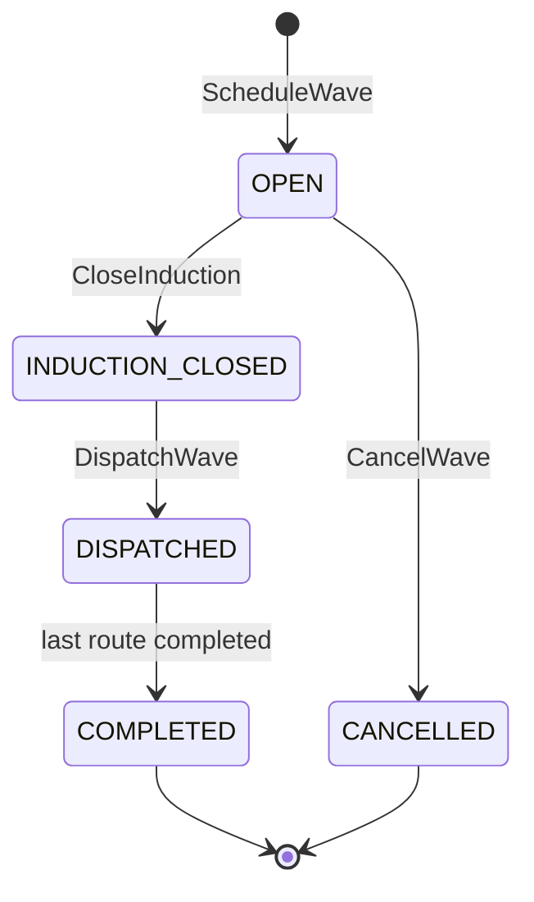
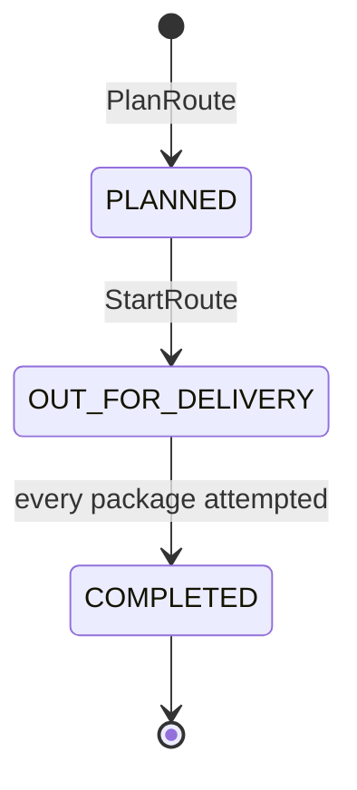
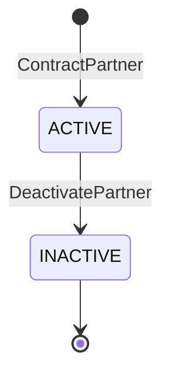
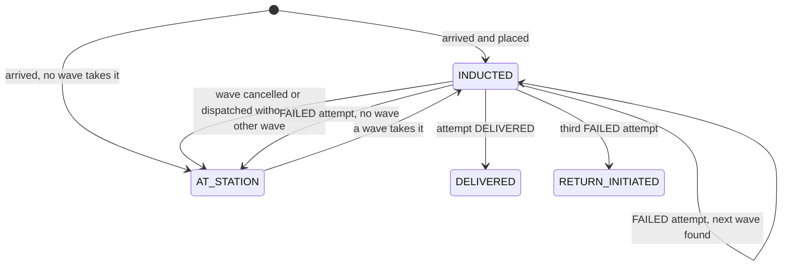

# Aggregate design canvas

Following the ddd-crew [Aggregate Design Canvas v1.1](https://github.com/ddd-crew/aggregate-design-canvas). The context has **four aggregate roots**, each in its own package under `internal/domain`: `DeliveryWave` (`wave`), `Route` (`route`), `DeliveryServicePartner` (`partner`) and `PackageAttemptHistory` (`history`, the Gap Register G16 read-side counter). Aggregates reference each other by id only, no foreign key crosses an aggregate in the schema, and each use case changes one aggregate per transaction (policies that touch several do so in sequence inside one `UnitOfWork`). Optimistic concurrency: every aggregate has a `version`; a stale save is `ErrConcurrentUpdate` (409 `concurrent-update`).

Source: `internal/domain/{wave,route,partner,history,shared}`, `internal/adapters/outbound/postgres/migrations/0001_last_mile_delivery_schema.up.sql`, [ADR 0002](/docs/adr/0002-aggregates-and-invariants).

## DeliveryWave

**Name / id**: `wave.DeliveryWave`, `waveId` (`wave-<uuid>`).

**Description**: one dispatch wave of one delivery station on one service date: induct cutoff, delivery window, stop capacity in **stops** (distinct stop keys), and the inductions (tracking number, `stopKey`, instant, position).

Source: `internal/domain/wave/wave.go` (`move`, `Induct`, `Cancel`).

| Invariant | Enforced by |
| --- | --- |
| `inductCutoffAt < windowStart < windowEnd` | `ErrInvalidWaveTimes`, table check `delivery_waves_times_check` |
| assigned stops `<=` capacity; a package joining an existing stop takes no capacity | `ErrWaveFull`, check `delivery_waves_capacity_check` |
| a package joins only an `OPEN` wave and only before the cutoff | `ErrInductionClosed` |
| a package is inducted once per wave | `ErrAlreadyInducted`, primary key `(wave_id, tracking_number)` |
| `CANCELLED` exactly when a cancel reason exists | check `delivery_waves_cancel_reason_check` |
| only the transitions above | `shared.ErrIllegalTransition` |

**Commands and events**

| Command | Transition | Issued by | Event |
| --- | --- | --- | --- |
| `ScheduleWave` | creates `OPEN` | REST `POST /waves` | `DeliveryWaveScheduled` |
| `Induct` (via `InductOnArrival`, `InductDeferredOnSchedule`, `RetryNextWave`, re-induction) | `OPEN`, assigned stops + (new stop only) | policies | `DeliveryWaveCapacityChanged` |
| `CloseInduction` | `OPEN` to `INDUCTION_CLOSED` | REST | none |
| `DispatchWave` | `INDUCTION_CLOSED` to `DISPATCHED` | REST | none (leftovers re-inducted) |
| `Complete` | `DISPATCHED` to `COMPLETED` | policy `CompleteWaveOnLastRoute` | none |
| `CancelWave` | `OPEN` to `CANCELLED` | REST | `DeliveryWaveCancelled` |

**Corrective policies**: `InductOnArrival` (earliest eligible wave; full or closed waves are skipped), `InductDeferredOnSchedule` (a new wave takes the packages waiting at the station), `RetryNextWave`, re-induction of cancel and dispatch leftovers (A10, A11, G17), `CompleteWaveOnLastRoute` (A9). Neighbours `delivery-promise` and `order-sourcing` react to `DeliveryWaveScheduled` and `DeliveryWaveCapacityChanged`; a wave with no remaining stops stops being offered.

**Throughput / size**: one write per newly inducted stop, in bursts with each `LoadArrived`; the wave row is contended in a burst, hence the version check and the retry by the consumer. A handful of scalar columns plus one `wave_inductions` row per package.

## Route

**Name / id**: `route.Route`, `routeId` (`route-<uuid>`).

**Description**: one partner's van route within one wave: ordered stops, each with the tracking numbers delivered there, and the append-only list of attempts (`DELIVERED` or `FAILED` with a reason).

Source: `internal/domain/route/route.go` (`Plan`, `Start`, `RecordAttempt`, `Complete`).

| Invariant | Enforced by |
| --- | --- |
| at least one stop, numbered `1..n`, no tracking number twice | `shared.ErrValidation` |
| the wave is `INDUCTION_CLOSED` when planning, `DISPATCHED` when starting | `shared.ErrIllegalTransition` |
| the partner is active and belongs to the wave's station | `ErrPartnerInactive`, `ErrPartnerStationMismatch` |
| stops `<=` the partner's van capacity | `ErrRouteOverCapacity` |
| every package is inducted in the wave, on no other route, and a stop's packages share one `stopKey` | `ErrPackageNotInducted`, `ErrPackageAlreadyRouted`, `ErrStopKeyMismatch` |
| an attempt only on an `OUT_FOR_DELIVERY` route, on a package of the route, once per package | `ErrRouteNotStarted`, `ErrPackageNotOnRoute`, `ErrAttemptAlreadyRecorded` |
| a package is delivered at most once across routes | `ErrAlreadyDelivered`, partial unique index `idx_route_attempts_delivered_once` |
| `failureReason` exactly when `FAILED` | check `route_attempts_reason_check` |
| completion needs every package attempted | `ErrRouteIncomplete` |

The van capacity belongs to another aggregate: `PlanRoute` reads the partner when the route is created and checks the stop count; a later change to the partner does not re-check planned routes.

| Command | Transition | Issued by | Event |
| --- | --- | --- | --- |
| `PlanRoute` | creates `PLANNED` | REST `POST /routes` | `RoutePlanned` (analytics topic) |
| `StartRoute` | `PLANNED` to `OUT_FOR_DELIVERY` | REST `POST /routes/{routeId}:start` | `PackageOutForDelivery` per package |
| `RecordAttempt` | records the attempt | REST `POST /routes/{routeId}/attempts` | `DeliveryAttempted` |
| `Complete` | `OUT_FOR_DELIVERY` to `COMPLETED` | inside `RecordAttempt` when the last package is attempted | none |

**Neighbour reaction**: `shipping-and-tracking` turns `PackageOutForDelivery` and `DeliveryAttempted` into scans on its package journey.

**Throughput / size**: one write per attempt, from one driver app per route (low contention), peaking inside the delivery window. A route holds up to the van capacity in stops.

## DeliveryServicePartner

**Name / id**: `partner.DeliveryServicePartner`, `dspId` (`dsp-<uuid>`).

**Description**: an independent delivery business contracted to a station, with its vans. Rules: a positive van capacity; active partners only get new routes.

Source: `internal/domain/partner/partner.go` (`Contract`, `Deactivate`).

| Invariant | Enforced by |
| --- | --- |
| van capacity `> 0` | `ErrInvalidVanCapacity`, check `delivery_service_partners_van_capacity_check` |
| `ACTIVE` to `INACTIVE` only (G34) | `shared.ErrIllegalTransition` |

Commands: `ContractPartner` (REST `POST /partners`), `DeactivatePartner` (REST `POST /partners/{dspId}:deactivate`). **Events**: none. Throughput rare, one row per partner.

## PackageAttemptHistory

**Name / id**: `history.History`, keyed by the tracking number. One row per package that reached the station (G16).

**Description**: where a package is in its last-mile life and how many attempts failed.

Source: `internal/domain/history/history.go` (`Arrive`, `Place`, `Unplace`, `RecordFailure`, `RecordDelivered`; `MaxFailedAttempts = 3`).

| Invariant | Enforced by |
| --- | --- |
| failed attempts between 0 and 3 | check `package_histories_failed_check` |
| `RETURN_INITIATED` exactly when 3 attempts failed | `history.Restore` (corrupt otherwise) |

Commands: raised only by policies (`InductOnArrival`, `RecordAttempt`, `ScheduleWave` sweep, re-induction). **Events**: `PackageInductionDeferred` (a package no wave takes), `PackageReturnInitiated` (third failure).

## Read models

Local, event-fed copies that enforce no rule of their own and are not aggregates:

| Read model | Table | Fed by | Used by |
| --- | --- | --- | --- |
| stations | `rm_stations` | `NodeRegistered` | `ScheduleWave`, `ContractPartner` (known station?), `InductOnArrival` (is the node a station?) |
| service areas | `rm_station_service_areas` | `ServiceAreaAssigned` | station lookup by postal prefix |
| package stops | `rm_package_stops` | `LabelIssued` | stop grouping (`stopKey`), postal prefix in `GetWaveStops` |
| inbound packages | `rm_inbound_packages` | `LoadArrived` | arrival record |

All are written through the inbox (`processed_events`), so a redelivered event is applied once.
