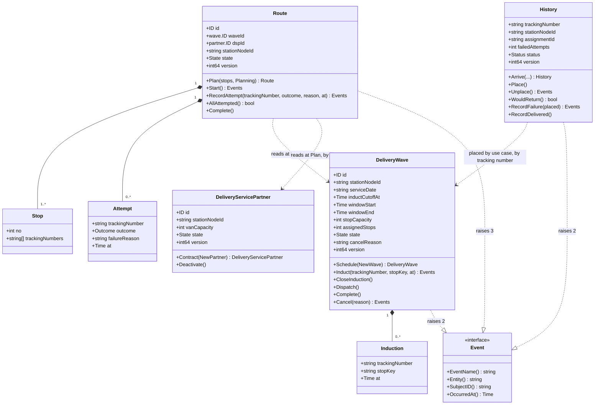
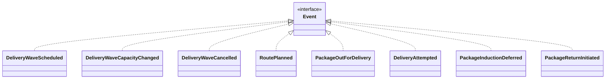
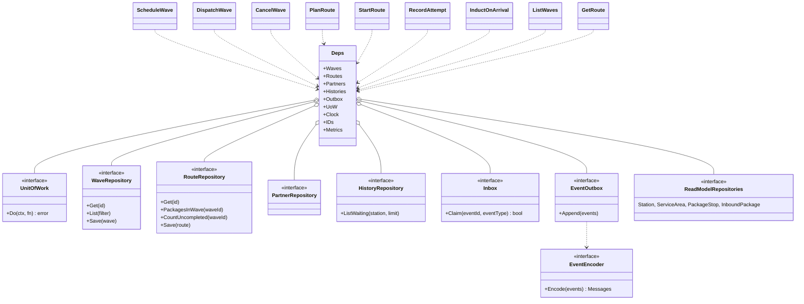

# Class diagram

The domain types as built, then the hexagonal ports and the adapters that implement them. Go has no classes; each box is a struct or interface and the members are the exported methods that matter. Aggregates are in `internal/domain/{wave,route,partner,history,shared}`; ports in `internal/application/ports/ports.go`.

## Domain model

Source: `internal/domain/wave/wave.go`, `route/route.go`, `partner/partner.go`, `history/history.go`, `shared/shared.go`, and the three `events.go`. The dotted `..>` arrows are read-by-id relations enforced in the use case, never object references.

## Domain events

Source: `internal/domain/{wave,route,history}/events.go`. Entities: `wave`, `route`, `packageattempthistory`.

## Application layer and ports

Source: `internal/application/ports/ports.go`, `internal/application/usecases/*.go` (`Deps`, `writer`, one struct per use case; also `CloseInduction`, `ContractPartner`, `DeactivatePartner`, `GetWaveStops`, `ApplyNodeRegistered`, `ApplyServiceAreaAssigned`, `ApplyLabelIssued`).

## Adapters that exist

| Port | Adapter | Package |
| --- | --- | --- |
| `WaveRepository`, `RouteRepository`, `PartnerRepository`, `HistoryRepository`, read-model repositories | pgx repositories | `internal/adapters/outbound/postgres` |
| `UnitOfWork` | transaction in the context (`pgtx`) | `.../postgres`, `.../postgres/pgtx` |
| `Inbox` | `processed_events` claim | `.../postgres` |
| `EventOutbox` + `EventEncoder` | outbox append with trace headers + CloudEvents encoder | `.../postgres`, `.../kafka` |
| outbox `Store` / `Sink` | `OutboxRepo` (`SKIP LOCKED`) / Kafka relay sink | `.../postgres`, `.../kafka`, relay in `.../outbox` |
| `Clock`, `IDGenerator` | wall clock, uuid ids | `.../system` |
| `AttemptMetrics` | OTel counter | `.../telemetry` |
| inbound | chi REST, three Kafka consumers, MCP server, A2A server | `.../inbound/{http,kafka,mcp,a2a}` |
| test doubles | in-memory repositories (never linked into `cmd/**`) | `.../outbound/memory` |
