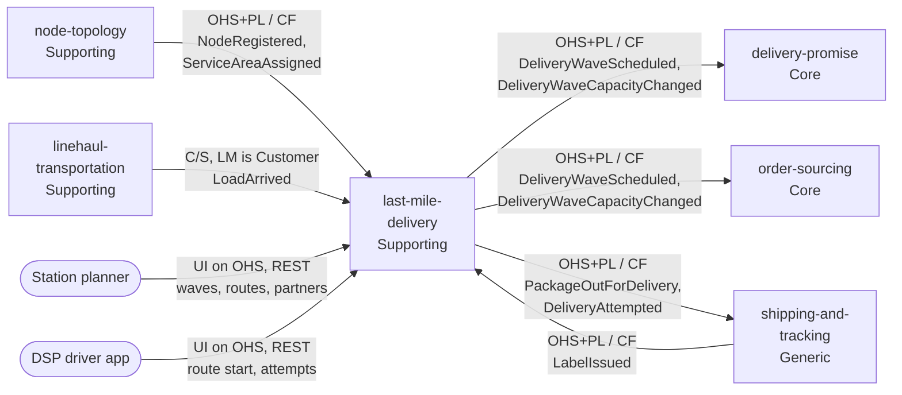

# Context map

This context's slice of the retail network's context map, following [Context Mapping](https://github.com/ddd-crew/context-mapping). The network-wide map is on [warehouse-docs](https://iqvo.github.io/warehouse-docs/network/strategic-design/context-map). Every edge is asynchronous (Kafka) except the two human or app clients; the producer and consumer sides of each edge were found in the sibling repositories on `develop`.

Source: `internal/adapters/inbound/kafka/consumers.go`, `internal/adapters/outbound/kafka/encoder.go`, `internal/adapters/inbound/http/server.go`, `apis/asyncapi.yaml`. Legend: arrows point from upstream to downstream. OHS = Open Host Service, PL = Published Language, CF = Conformist, C/S = Customer/Supplier. Omitted: the events nobody is named as consuming (`DeliveryWaveCancelled`, `PackageInductionDeferred`, `PackageReturnInitiated`, `RoutePlanned` on the analytics topic), and Postgres and Kafka as infrastructure.

## Relationships

| Neighbour | Class | Direction | Pattern | Channel | Messages |
| --- | --- | --- | --- | --- | --- |
| `node-topology` | Supporting | upstream (we are downstream) | OHS + PL / Conformist | Kafka `retailnetwork.node-topology.events` | `NodeRegistered`, `ServiceAreaAssigned` |
| `linehaul-transportation` | Supporting | upstream | Customer/Supplier, we are the Customer | Kafka `retailnetwork.linehaul-transportation.events` | `LoadArrived` |
| `shipping-and-tracking` | Generic | upstream for labels | OHS + PL / Conformist | Kafka `retailnetwork.shipping-and-tracking.events` | `LabelIssued` |
| `delivery-promise` | Core | downstream (we are upstream) | OHS + PL / Conformist | Kafka `retailnetwork.last-mile-delivery.events` | `DeliveryWaveScheduled`, `DeliveryWaveCapacityChanged` |
| `order-sourcing` | Core | downstream | OHS + PL / Conformist | same | same |
| `shipping-and-tracking` | Generic | downstream for facts | OHS + PL / Conformist | same | `PackageOutForDelivery`, `DeliveryAttempted` |
| Station planner | person | calls us | UI on Open Host | REST | `ScheduleWave`, `CloseInduction`, `DispatchWave`, `CancelWave`, `PlanRoute`, `ContractPartner`, `DeactivatePartner`, list and read |
| DSP driver app | external organisation | calls us | UI on Open Host | REST | `StartRoute`, `RecordAttempt` |

`shipping-and-tracking` is both an upstream (its `LabelIssued` gives the stop grouping) and a downstream (it turns our out-for-delivery and attempt facts into journey scans); the two edges use different topics.

## Notes on the patterns

- **Open Host + Published Language toward three consumers.** The wave and attempt events are versioned CloudEvents (`dataschema urn:retailnetwork:last-mile-delivery:<stream>:<EventName>:v1`). No consumer negotiates their shape.
- **Customer/Supplier with linehaul.** `LoadArrived` carries `destinationNodeId` and `trackingNumbers` precisely so that a station can induct; the supplier names this context as a consumer.
- **Conformist toward node-topology and shipping-and-tracking.** This context takes the published events as they are and keeps only the fields it needs, ignoring the rest (tolerant reader), in its own read models. It never calls back.
- **Anti-corruption by local copy.** `rm_stations`, `rm_station_service_areas`, `rm_package_stops` and `rm_inbound_packages` are the translation layer; no aggregate points at them.

## Separate ways

| Context | Why no edge |
| --- | --- |
| `customer-ordering` | Holds the ship-to address; this context never sees PII. Delivery reaches the customer through `shipping-and-tracking`. |
| `offer-availability` | Catalogue and listings play no part at the station. |
| `vendor-connectivity` | Vendors never operate a station. |
| `node-performance` | Scores vendor nodes, not stations. |
| warehouse-systems fleet (for example `network-fulfillment`) | Hard organisational boundary: the only seam is the Vendor API; a delivery station is network-operated. |

See [Integration](/docs/ecosystem/integration) for the failure behaviour of each edge.
