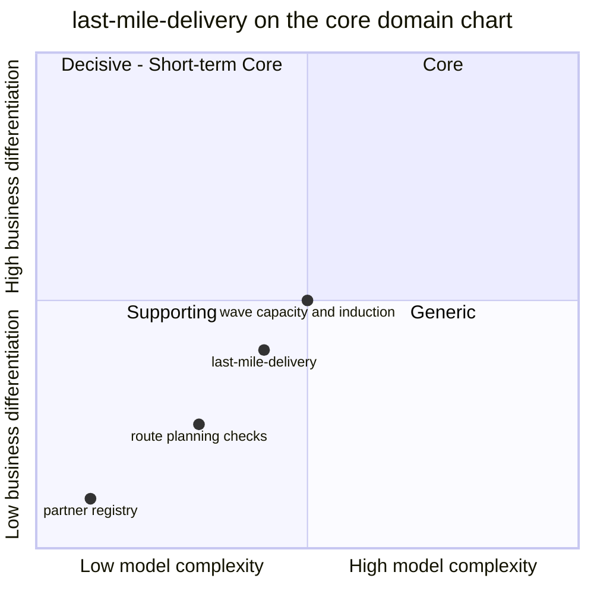

# Core domain chart

Following the ddd-crew [Core Domain Charts](https://github.com/ddd-crew/core-domain-charts): business differentiation on the vertical axis, model complexity on the horizontal axis. Mermaid numbers the quadrants 1 = top-right (Core), 2 = top-left, 3 = bottom-left (Supporting), 4 = bottom-right (Generic). The coordinates are a judgement from the evidence below, not a measurement; the class itself is the fleet verdict ([Subdomain classification](/docs/ddd/subdomain-classification)).

Source: `docs/adr/0001-last-mile-delivery-bounded-context.md`, `docs/adr/0002-aggregates-and-invariants.md`, `internal/domain/{wave,route,partner,history}`. Sibling contexts are omitted (their own charts place them).

## Classification: Supporting

**Business differentiation is moderate-low (y = 0.40).** The delivery promise needs a published wave with a stop capacity, and that makes the wave semantics matter, so the context is not Generic. But the context does not compute a promise or choose a path; it keeps facts the Core contexts consume, and routing itself is replaceable: the caller sends the stops and the code only validates them.

**Model complexity is low to moderate (x = 0.42).** Evidence from the code:

- Four small aggregates (`DeliveryWave` has the most rules: ordered times, capacity, cutoff, uniqueness, a five-state machine).
- Cross-aggregate behaviour is application policy, not domain rules: `InductOnArrival`, `InductDeferredOnSchedule`, `RetryNextWave`, `CompleteWaveOnLastRoute`.
- Capacity counted in stops with grouping by `stopKey` is the one non-trivial rule, and it lives inside `DeliveryWave.Induct`.
- Four event-fed read models are plumbing, not model.
- 100 % mutation efficacy over five domain packages and a 90 % coverage gate on domain plus application ([Testing](/docs/development/testing)).

The **wave capacity and induction** logic sits a little higher (0.50, 0.50): it is where the promise's last leg is decided. The **route planning checks** (0.30, 0.25) are validations. The **partner registry** (0.10, 0.10) is a positive number and an active flag.

## Evolution

Custom-built, in genesis: scaffolded and decided on 2026-10-23 (ADRs 0001 to 0005), with the MCP server and console remote on 2026-10-24, observability on 2026-10-26 and the A2A agent on 2026-10-29. What would move it: a sequencing or load-balancing engine for routes that the promise relied on would push it towards Core; replacing the wave bookkeeping with a bought dispatch product behind an anti-corruption layer would push it down to Generic. Out of scope today: route optimisation, ship-to addresses, customer notification, customer returns.
