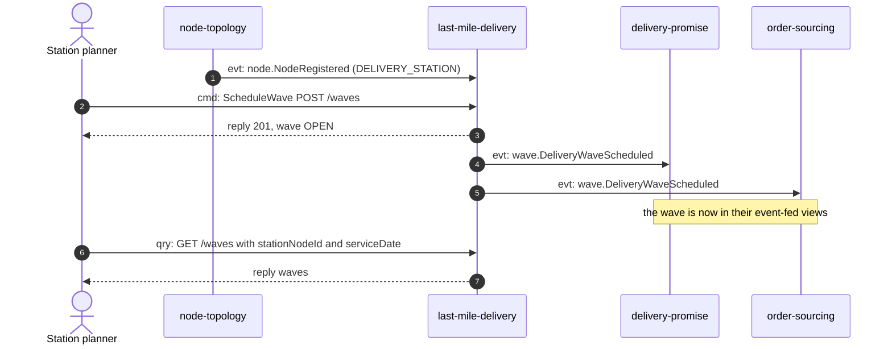
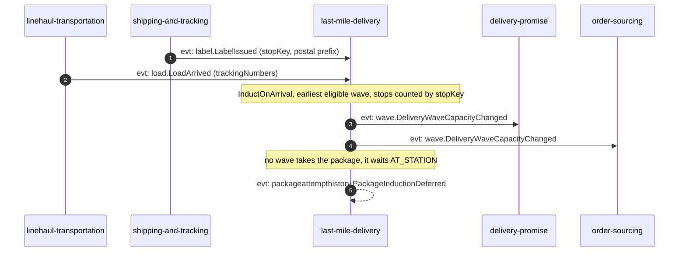
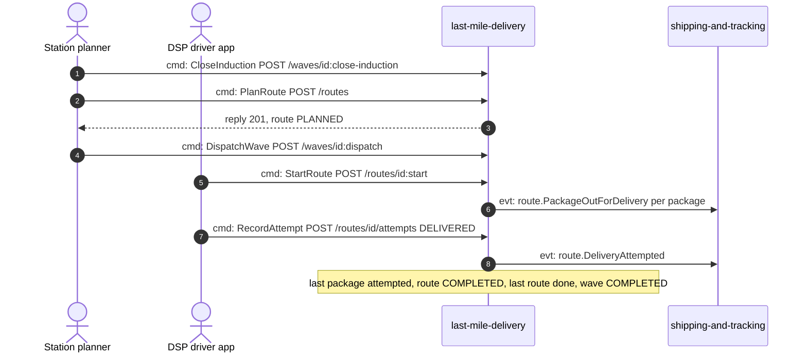
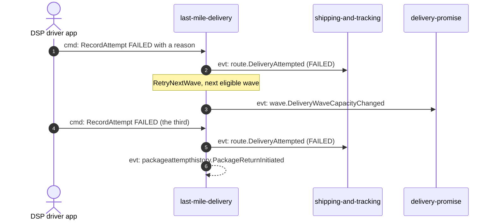

# Domain message flow

Following ddd-crew [Domain Message Flow Modelling](https://github.com/ddd-crew/domain-message-flow-modelling). Four scenarios. Participants are contexts and actors. Every arrow is a message prefixed `cmd:` (command), `qry:` (query) or `evt:` (event). Events travel on Kafka through the producer's outbox; the diagrams draw them from producer to consumer and leave Kafka out. Event names are written `<entity>.<EventName>`; the full types are on [Domain events](/docs/ddd/domain-events). Scenarios 2 and 3 are the happy path from arrival to the doorstep, split to stay readable. Scenario 4 is the failure path.

Source: `internal/adapters/inbound/http/server.go`, `internal/adapters/inbound/kafka/consumers.go`, `internal/adapters/outbound/kafka/encoder.go`, `internal/application/usecases/*.go`.

## 1. A wave is scheduled and becomes promisable

Omitted: the `unknown-station` and `invalid-wave-times` rejections (422) and how `delivery-promise` quotes on the wave.

## 2. A load arrives and its packages are inducted

A later `ScheduleWave` sweeps the waiting packages into the new wave.

## 3. Plan, dispatch, deliver

`RoutePlanned` goes to the analytics topic only and has no context consumer.

## 4. A delivery fails

If no wave takes a package after a failure it waits `AT_STATION` and `PackageInductionDeferred` is published instead of a capacity change. A fifth scenario, cancelling a wave, is on [Sequence diagrams](/docs/ddd/sequence-diagrams): every package it held is re-inducted the same way.
