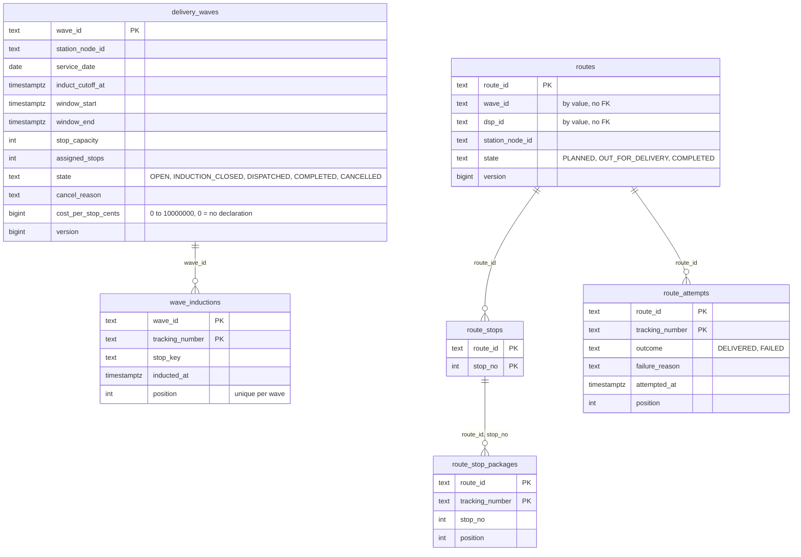
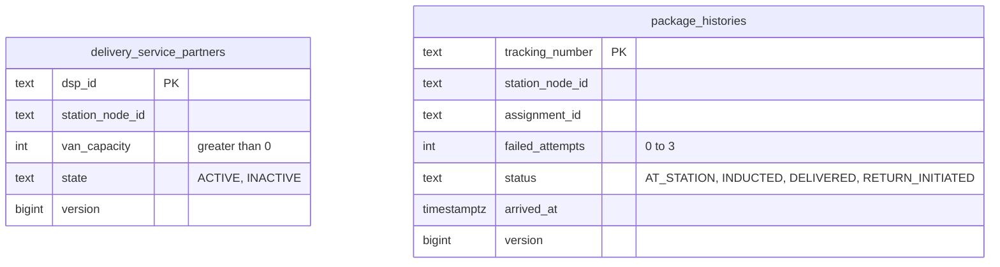
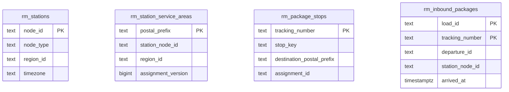
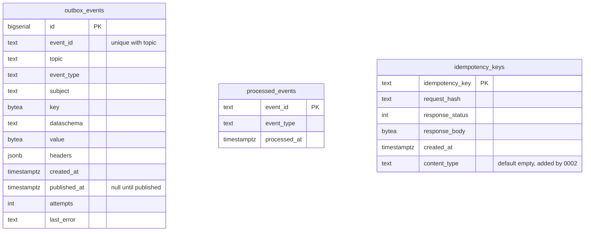
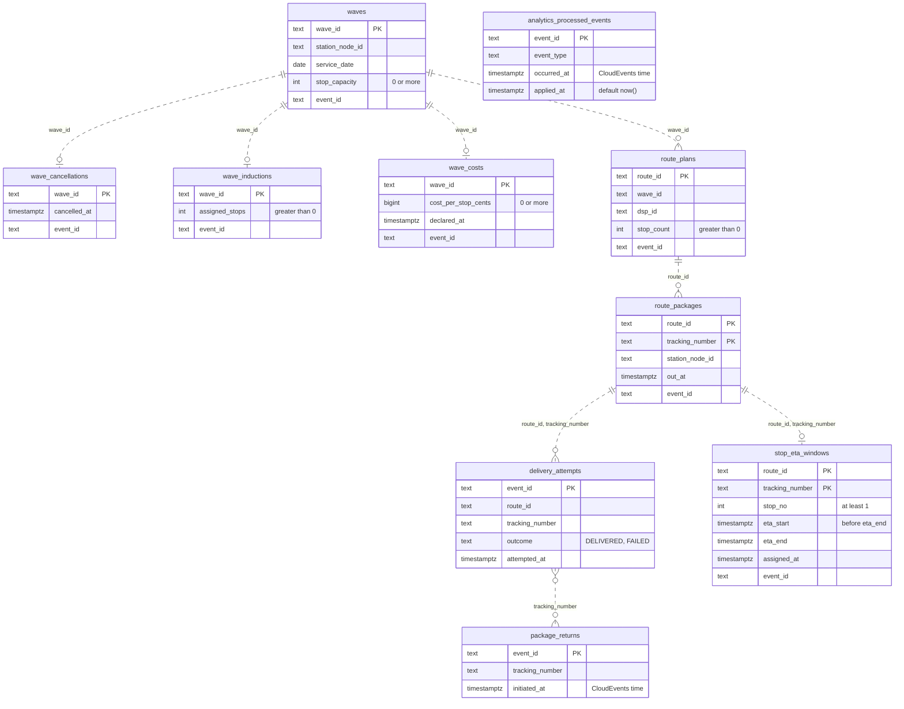

# Entity-relationship diagram

Two databases, each with its own embedded golang-migrate migrations and its own diagrams below:

- **OLTP** (written by `cmd/api`): `internal/adapters/outbound/postgres/migrations/` holds three migrations, `0001_last_mile_delivery_schema` (creates all **15 tables**), `0002_idempotency_keys_global` (reshapes `idempotency_keys`) and `0003_wave_stop_cost` (adds `delivery_waves.cost_per_stop_cents`); neither of the later two creates or drops a table. They are applied at boot by golang-migrate.
- **Analytics** (written only by `cmd/lm-projector`, read by `cmd/lm-reports`): `analytics/migrations/0001_last_mile_facts.up.sql` creates **9 tables**, described in [Analytics database](#analytics-database).

The OLTP schema has one table per aggregate root, child tables for the collections it owns, four `rm_` read-model tables and three infrastructure tables. No foreign key crosses an aggregate or a context: ids of other aggregates are carried by value, so the diagrams below show the real foreign keys only inside an aggregate.

## Aggregates

Source: `0001_last_mile_delivery_schema.up.sql` (`delivery_waves`, `wave_inductions`, `routes`, `route_stops`, `route_stop_packages`, `route_attempts`) plus `0003_wave_stop_cost.up.sql` (`cost_per_stop_cents`, with the constraint `delivery_waves_cost_check`: `BETWEEN 0 AND 10000000`; rows stored before the migration keep 0, which reads as "no declaration").

Key constraints: `delivery_waves_times_check` (`induct_cutoff_at < window_start < window_end`), `delivery_waves_capacity_check` (`assigned_stops <= stop_capacity`), `delivery_waves_cancel_reason_check` (`CANCELLED` exactly when a reason exists); indexes `idx_delivery_waves_station_date` and the partial `idx_delivery_waves_open_cutoff` on `OPEN` waves (the induction scan); `idx_routes_wave`; `route_attempts_reason_check` (a `failure_reason` exactly when `FAILED`); the partial unique index `idx_route_attempts_delivered_once` on `tracking_number WHERE outcome = 'DELIVERED'` (a package is delivered at most once, across routes).

## Partners and package histories

Source: same migration. `idx_package_histories_waiting` is a partial index on `(station_node_id, arrived_at, tracking_number) WHERE status = 'AT_STATION'`: the sweep that a newly scheduled wave runs.

## Read models (event-fed)

Source: same migration. Fed by `NodeRegistered` (`rm_stations`), `ServiceAreaAssigned` (`rm_station_service_areas`), `LabelIssued` (`rm_package_stops`) and `LoadArrived` (`rm_inbound_packages`). No aggregate points at them.

## Infrastructure

Source: `0001_last_mile_delivery_schema.up.sql`; `idempotency_keys` as reshaped by `0002_idempotency_keys_global.up.sql` (it deleted the old rows, dropped the `route` column and the old primary key, added `content_type` and made `idempotency_key` the primary key).

- `outbox_events` is the transactional outbox. `event_id` is the CloudEvents id minted at encode time, so a relay retry republishes the same id; `(event_id, topic)` is unique; the partial index `idx_outbox_events_unpublished` on `id WHERE published_at IS NULL` serves the relay's claim; `attempts` and `last_error` carry the failure count the attempt cap reads.
- `processed_events` is the inbox: the consumer claims the CloudEvents id with `INSERT ... ON CONFLICT DO NOTHING` in the same transaction as the effect, so a rollback un-claims it.
- `idempotency_keys` holds the `Idempotency-Key` middleware's stored 2xx and 4xx answers (status, content type, body), keyed by the key alone (global; the request hash decides replay or 409); rows older than 24 hours are ignored by the lookup (there is no purge job).

Down migrations: `0001_last_mile_delivery_schema.down.sql`, `0002_idempotency_keys_global.down.sql` and `0003_wave_stop_cost.down.sql` in the same directory.

## Analytics database

The analytical database is separate from the OLTP one and is a projection of this context's own two topics (`retailnetwork.last-mile-delivery.events` and `.analytics`), not a source of truth: it can be dropped and rebuilt from them. `analytics/migrations/0001_last_mile_facts.up.sql` creates nine tables. There are no foreign keys; the lines below are the joins the reports in `internal/adapters/outbound/analyticsstore/reader.go` make, by value. The `wave_inductions` table here is not the OLTP table of the same name: it holds one row per wave with the highest `assigned_stops`.

Source: `0001_last_mile_facts.up.sql` and `0002_stop_eta_windows.up.sql`. Each fact table is fed by one event type:

- `waves` by `wave.DeliveryWaveScheduled`; `wave_inductions` by the highest `assignedStops` of `wave.DeliveryWaveCapacityChanged`; `wave_cancellations` by `wave.DeliveryWaveCancelled`; `wave_costs` by `wave.WaveCostDeclared` (the last declaration wins; 0 is a declared cost).
- `route_plans` by `route.RoutePlanned` (the analytics topic); `route_packages` by `route.PackageOutForDelivery`; `delivery_attempts` by `route.DeliveryAttempted` (`attempted_at` is the attempt's own instant); `stop_eta_windows` (migration `0002_stop_eta_windows`, ADR 0013: one row per package of a `route.StopEtaWindowAssigned`, the first row of a route and package stays) by `route.StopEtaWindowAssigned`; `package_returns` by `packageattempthistory.PackageReturnInitiated` (`initiated_at` is the CloudEvents time, the payload carries no instant).
- `analytics_processed_events` is the projector's inbox: every applied CloudEvents id is recorded once, in the same transaction as its effect on a fact table; `occurred_at` is the basis of `GET /reports/freshness`.

Indexes: `idx_delivery_attempts_route` on `(route_id, tracking_number)`, `idx_delivery_attempts_tracking` on `(tracking_number, attempted_at)`, `idx_delivery_attempts_attempted_at`, `idx_package_returns_initiated_at`, `idx_waves_service_date`, `idx_analytics_processed_events_occurred_at` and `idx_stop_eta_windows_tracking` on `(tracking_number)`. Down migration: `0001_last_mile_facts.down.sql`.
