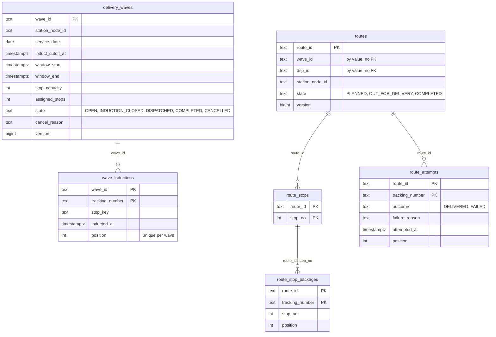
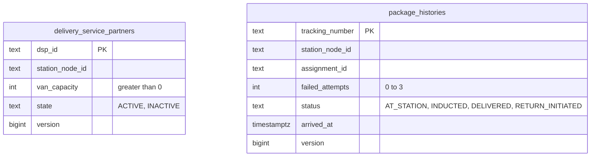
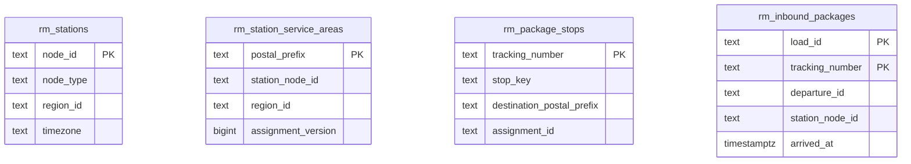
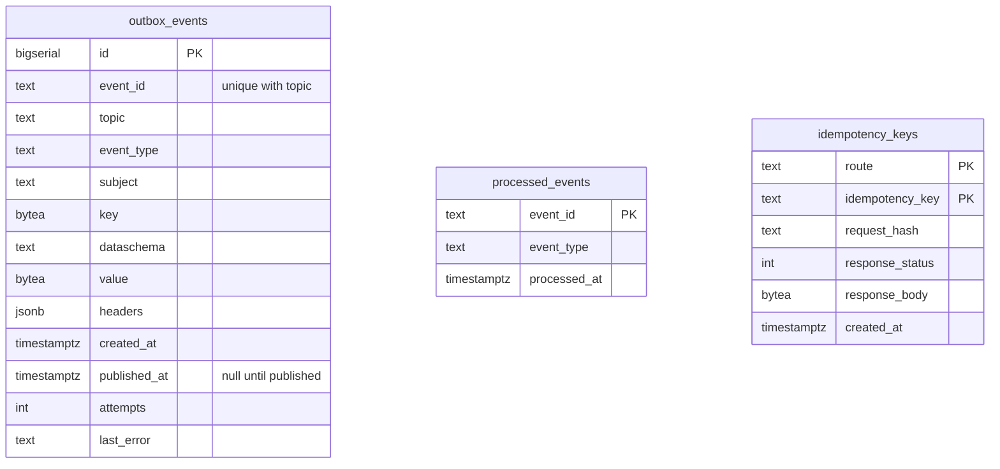

# Entity-relationship diagram

The Postgres schema created by the single migration `internal/adapters/outbound/postgres/migrations/0001_last_mile_delivery_schema.up.sql`: **15 tables**, embedded in the binary and applied at boot by golang-migrate. One table per aggregate root, child tables for the collections it owns, four `rm_` read-model tables and three infrastructure tables. No foreign key crosses an aggregate or a context: ids of other aggregates are carried by value, so the diagrams below show the real foreign keys only inside an aggregate.

## Aggregates

Source: `0001_last_mile_delivery_schema.up.sql` (`delivery_waves`, `wave_inductions`, `routes`, `route_stops`, `route_stop_packages`, `route_attempts`).

Key constraints: `delivery_waves_times_check` (`induct_cutoff_at < window_start < window_end`), `delivery_waves_capacity_check` (`assigned_stops <= stop_capacity`), `delivery_waves_cancel_reason_check` (`CANCELLED` exactly when a reason exists); indexes `idx_delivery_waves_station_date` and the partial `idx_delivery_waves_open_cutoff` on `OPEN` waves (the induction scan); `idx_routes_wave`; `route_attempts_reason_check` (a `failure_reason` exactly when `FAILED`); the partial unique index `idx_route_attempts_delivered_once` on `tracking_number WHERE outcome = 'DELIVERED'` (a package is delivered at most once, across routes).

## Partners and package histories

Source: same migration. `idx_package_histories_waiting` is a partial index on `(station_node_id, arrived_at, tracking_number) WHERE status = 'AT_STATION'`: the sweep that a newly scheduled wave runs.

## Read models (event-fed)

Source: same migration. Fed by `NodeRegistered` (`rm_stations`), `ServiceAreaAssigned` (`rm_station_service_areas`), `LabelIssued` (`rm_package_stops`) and `LoadArrived` (`rm_inbound_packages`). No aggregate points at them.

## Infrastructure

Source: same migration.

- `outbox_events` is the transactional outbox. `event_id` is the CloudEvents id minted at encode time, so a relay retry republishes the same id; `(event_id, topic)` is unique; the partial index `idx_outbox_events_unpublished` on `id WHERE published_at IS NULL` serves the relay's claim; `attempts` and `last_error` carry the failure count the attempt cap reads.
- `processed_events` is the inbox: the consumer claims the CloudEvents id with `INSERT ... ON CONFLICT DO NOTHING` in the same transaction as the effect, so a rollback un-claims it.
- `idempotency_keys` holds the `Idempotency-Key` middleware's stored 2xx and 4xx answers (status, content type, body), keyed by the key alone (global; the request hash decides replay or 409); rows older than 24 hours are ignored by the lookup (there is no purge job).

Down migration: `0001_last_mile_delivery_schema.down.sql` in the same directory.
