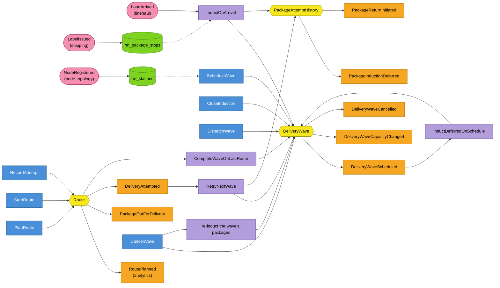
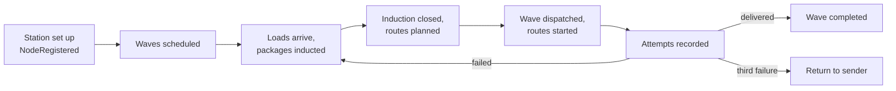

# EventStorming

Design-level EventStorming of the last mile, following the [EventStorming glossary and cheat sheet](https://github.com/ddd-crew/eventstorming-glossary-cheat-sheet). Sticky-note colours: **orange** domain event, **blue** command, **yellow** aggregate, **lilac** policy, **green** read model, **pink** external system or hotspot. Events are named as the code publishes them; read models are the `rm_*` tables.

Source: `internal/application/usecases/*.go`, `internal/domain/*/events.go`, `internal/adapters/inbound/kafka/consumers.go`.

## Process level: from arrival to the doorstep

## Hotspots

| Hotspot | What the code does today |
| --- | --- |
| A wave is full or closed when a package arrives | the package is tried against the next eligible wave, else it waits `AT_STATION` and `PackageInductionDeferred` is published |
| A wave is cancelled with packages in it | they are re-inducted onto the next eligible wave in the same transaction (G17), else deferred |
| The wave is dispatched while packages are on no route | they are re-inducted (A11) |
| Two packages for one address | one stop: they share a `stopKey`, take one capacity unit and must travel on one stop of a route |
| Label data not yet arrived at induction | the package is its own stop (`pkg:<trackingNumber>`) |
| A partner is deactivated with planned routes | the planned routes are not re-checked (G34: only new routes need an active partner) |
| Nobody consumes the cancel, deferred and return events | published for visibility and a future returns or notification context |
| A driver reports a delivered package twice | `already-delivered`, enforced in the aggregate and by a partial unique index |
| An attempt arrives on a route that was never started | `route-not-started` (409) |

## Policies

| Policy | Trigger | Reaction |
| --- | --- | --- |
| `InductOnArrival` | `LoadArrived` | induct every package into the earliest eligible wave, record the arrival, defer the unplaced |
| `InductDeferredOnSchedule` | a wave is scheduled | induct the packages waiting at the station, oldest first, at most 1000 |
| `RetryNextWave` | a `FAILED` attempt | place the package on the next eligible wave unless this is the third failure |
| `CompleteWaveOnLastRoute` | dispatch, or a route completes | complete the `DISPATCHED` wave when no route is left uncompleted |
| re-induction | cancel, dispatch | move the packages the wave cannot run |

## Big picture

