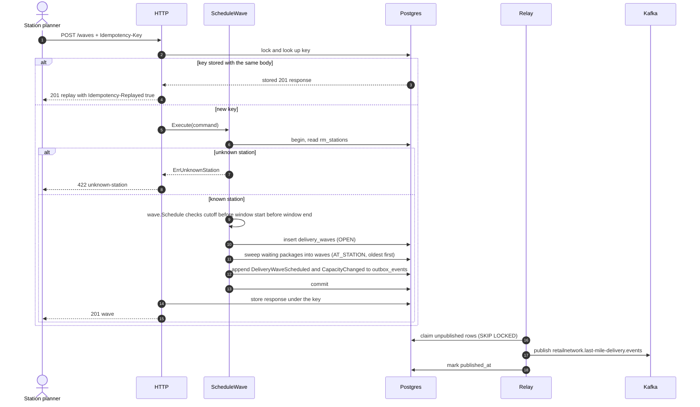
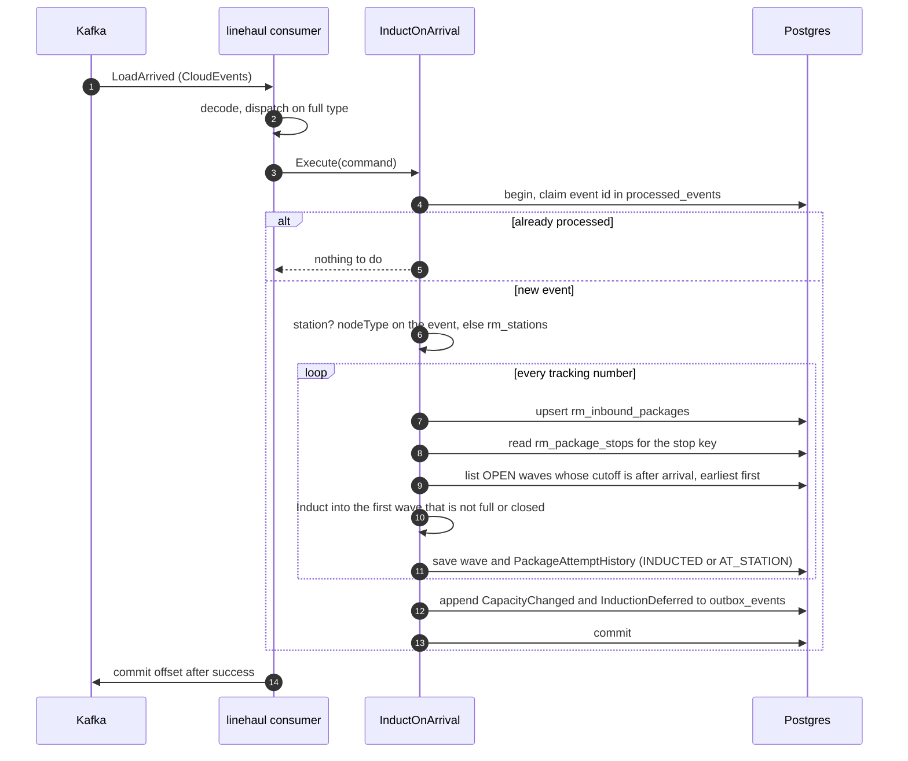
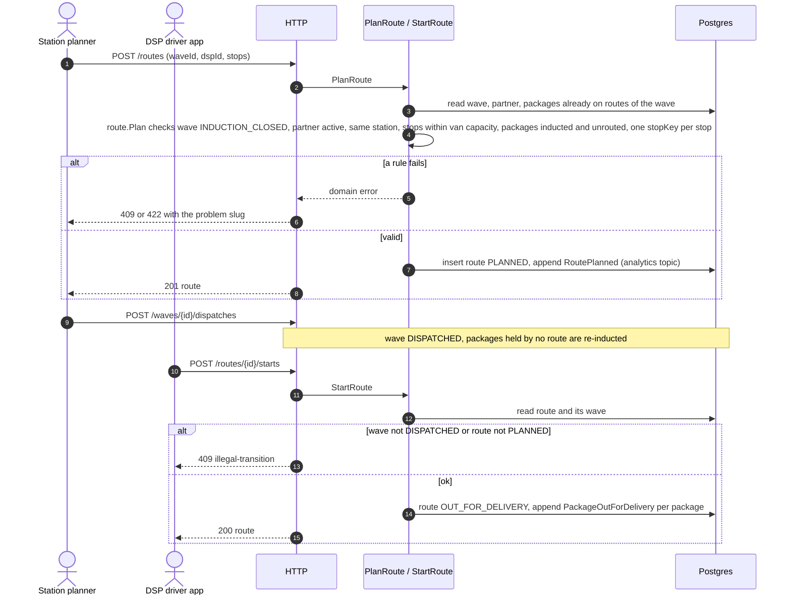
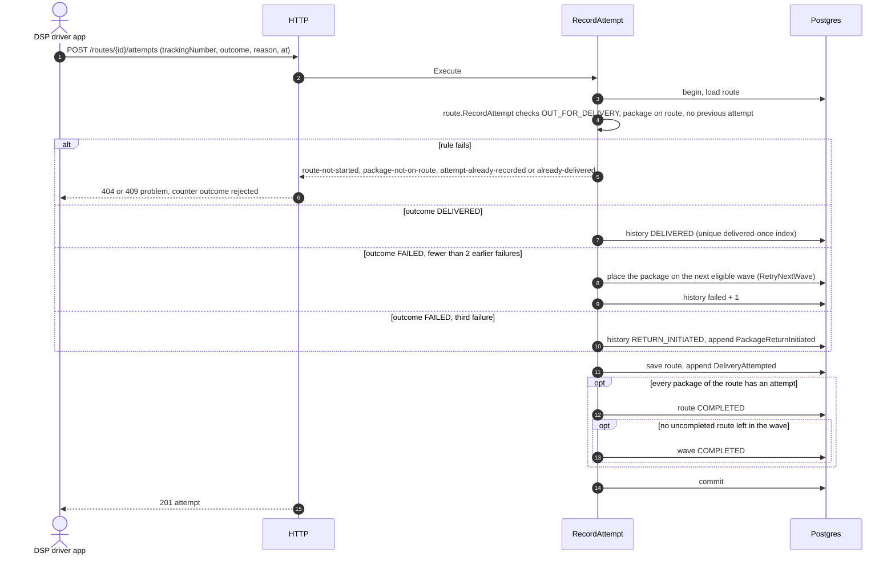
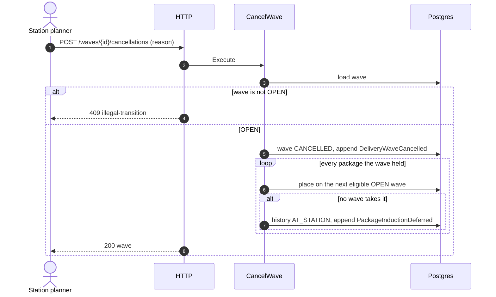
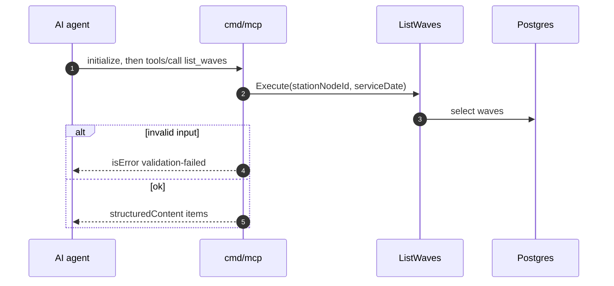

# Sequence diagrams

Adapter, use case, aggregate, repository and outbox for the main flows, with the error branches. Every write goes through `UnitOfWork.Do` (one Postgres transaction) and ends with events appended to `outbox_events` in that transaction. Participants: `HTTP` is the chi adapter with the `Idempotency-Key` middleware, `UC` the use case, `DB` Postgres through the repositories, `Relay` the outbox relay, `Kafka` the broker.

## 1. Schedule a wave

Source: `internal/adapters/inbound/http/idempotency.go`, `internal/application/usecases/waves.go` (`ScheduleWave`), `induct.go` (`sweepWaiting`), `internal/adapters/outbound/outbox/relay.go`.

## 2. A load arrives and its packages are inducted

On a transient error the unit of work rolls back (the event id is un-claimed) and the same message is retried, up to five attempts, then dead-lettered to `<topic>.dlq`. Source: `internal/adapters/inbound/kafka/{consumer,consumers,kafka}.go`, `internal/application/usecases/consumers.go`, `induct.go`.

## 3. Plan and start a route

Source: `internal/application/usecases/routes.go`, `internal/domain/route/route.go` (`Plan`, `checkPlanning`, `Start`).

## 4. Record an attempt (delivered, failed, third failure)

Source: `internal/application/usecases/routes.go` (`RecordAttempt`, `updateHistory`, `completeRouteIfDone`), `internal/domain/history/history.go` (`RecordFailure`, `WouldReturn`).

## 5. Cancel a wave

Source: `internal/application/usecases/waves.go` (`CancelWave`), `induct.go` (`reinduct`).

## 6. Read through MCP

The A2A `list_waves` and `get_route` skills call the same read use cases. Source: `internal/adapters/inbound/mcp/tools.go`, `internal/adapters/inbound/a2a/skills.go`.
