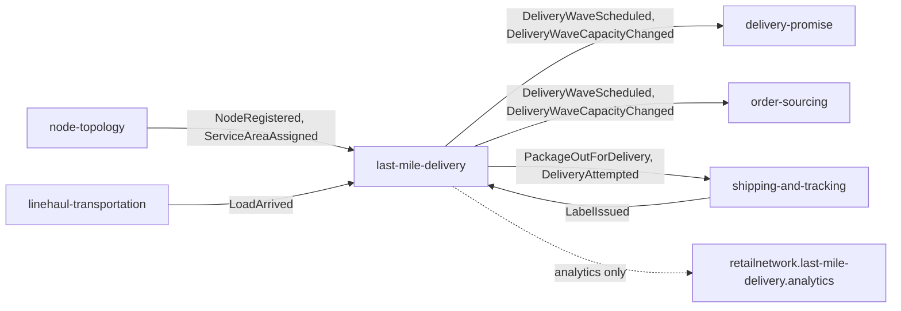

# Integration

Every upstream and downstream of `last-mile-delivery`, with protocol, contract and failure behaviour. The context is a **downstream consumer** of three upstreams and an **upstream publisher** to three downstreams, all over Kafka; it calls **no sibling synchronously** (REST, MCP or A2A) and has no outbound HTTP client at all. The rule is written in the repo's `CLAUDE.md` ("calls no sibling") and enforced for MCP and A2A by `TestMCPServerIsReadOnly` and `TestA2AAgentIsReadOnlyAndHasNoOutboundClient`. This service belongs to the retail network, not the warehouse-systems fleet; the fleet reaches the network only through the `vendor-connectivity` Vendor API, which this context does not touch.

Source: `internal/adapters/inbound/kafka/{consumer,consumers,deadletter}.go`, `internal/adapters/outbound/kafka/encoder.go`, `apis/asyncapi.yaml`, [ADR 0003](/docs/adr/0003-consumed-contracts-and-local-read-models), [ADR 0004](/docs/adr/0004-cloudevents-envelope-and-type-catalogue).

Source: `internal/adapters/inbound/kafka/consumers.go`, `internal/adapters/outbound/kafka/encoder.go`.

## Inbound: events consumed

All consumers use `segmentio/kafka-go` with a consumer group from an environment variable, commit the offset only after the effect is durable (at-least-once, effect idempotent through `processed_events`), and dispatch on the **full** CloudEvents `type`. Only the fields the context uses are decoded (tolerant reader); unknown fields and unknown types are ignored.

| Upstream | Topic | Event type | Fields used | Effect |
| --- | --- | --- | --- | --- |
| `node-topology` | `retailnetwork.node-topology.events` | `com.retailnetwork.logistics.node-topology.node.NodeRegistered` | `nodeId`, `nodeType`, `regionId`, `timezone` | `DELIVERY_STATION` nodes into `rm_stations` |
| `node-topology` | same | `com.retailnetwork.logistics.node-topology.servicearea.ServiceAreaAssigned` | `postalPrefix`, `deliveryStationNodeId`, `regionId`, `assignmentVersion` | into `rm_station_service_areas` if the version is newer |
| `linehaul-transportation` | `retailnetwork.linehaul-transportation.events` | `com.retailnetwork.logistics.linehaul-transportation.load.LoadArrived` | `loadId`, `departureId`, `destinationNodeId`, `nodeType`, `trackingNumbers`, `arrivedAt` | `rm_inbound_packages` and induction into waves (`InductOnArrival`) |
| `shipping-and-tracking` | `retailnetwork.shipping-and-tracking.events` | `com.retailnetwork.logistics.shipping-and-tracking.label.LabelIssued` | `trackingNumber`, `assignmentId`, `stopKey`, `destinationPostalPrefix` | into `rm_package_stops` (stop grouping) |

Relationship patterns: `node-topology` and `shipping-and-tracking` are Open Host Services with a Published Language and this context **conforms**; `linehaul-transportation` is Customer/Supplier with this context as the Customer (the producer lists it as a named consumer of `LoadArrived`).

**Failure behaviour.**

- The consumer processes one message at a time and does not fetch the next until the offset of the current one is committed.
- A transient error (database down, timeout) rolls the unit of work back and retries the **same** message with capped exponential backoff (200 ms doubling to 5 s), at most 5 attempts, then publishes it to `<topic>.dlq` (`retailnetwork.node-topology.events.dlq`, `.linehaul-transportation.events.dlq`, `.shipping-and-tracking.events.dlq`) with `x-dlq-*` headers and commits past it.
- A message that can never be applied (not a CloudEvents 1.0 message, undecodable `data`, invalid values) is dead-lettered at once, without retries.
- The DLQ publish itself is retried until it succeeds, so a message is never dropped silently.
- A broker connection blip (read timeout, reset, EOF) is slept off with the same backoff for up to 10 consecutive failures; beyond that the consumer ends and the process exits non-zero so the orchestrator restarts it.
- Topics are not provisioned: they are created by the first writer (`AllowAutoTopicCreation`), so a consumed topic that does not exist yet only shows as consumer retry logs, never as a failed `/readyz`.
- A consumer group that has no committed offset starts at the first available offset and replays the topic; replays are safe because of the inbox.
- Events are not guaranteed to arrive in an order across topics: `LoadArrived` can precede `NodeRegistered`. The `nodeType` on `LoadArrived` makes the station check independent of `rm_stations` when present; when absent a package arriving at an unknown node is ignored, not retried.

## Outbound: events published

Written to `outbox_events` in the aggregate's transaction and published by the relay (at-least-once, same CloudEvents `id` on retry, key = aggregate id, acks=all, hash balancer). Full catalogue and payloads: [Domain events](/docs/ddd/domain-events) and the [Event catalogue](/docs/api-reference/events).

| Event | Topic | Known downstream |
| --- | --- | --- |
| `DeliveryWaveScheduled`, `DeliveryWaveCapacityChanged` | `retailnetwork.last-mile-delivery.events` | `delivery-promise` (local wave view for its witness path), `order-sourcing` (network graph view) |
| `PackageOutForDelivery`, `DeliveryAttempted` | same | `shipping-and-tracking` (turns them into journey scans) |
| `DeliveryWaveCancelled`, `PackageInductionDeferred`, `PackageReturnInitiated` | same | no consumer in this repository's contract; available to analytics |
| `RoutePlanned` | `retailnetwork.last-mile-delivery.analytics` | analytics only |

**Failure behaviour.** A broker outage never fails a REST write: the row stays in the outbox and the relay retries every interval; a row that fails `OUTBOX_MAX_ATTEMPTS` (default 20) times is parked and logged at ERROR until an operator re-arms it ([Runbook](/docs/operations/runbook)). Consumers must be idempotent on the CloudEvents `id`. There is no schema registry; consumers read `dataschema` `urn:retailnetwork:last-mile-delivery:<stream>:<EventName>:v1`.

## Inbound: synchronous APIs

| Client | Surface | Notes |
| --- | --- | --- |
| Station planner (person or console) | REST on `:8080`, Kong path `/api/last-mile-delivery` | `POST /waves`, `GET /waves`, `GET /waves/{waveId}/stops`, the colon verbs, `POST /routes`, `GET /routes/{routeId}`, `POST /partners` |
| DSP driver app (external organisation) | REST: `POST /routes/{routeId}:start`, `POST /routes/{routeId}/attempts` | Unauthenticated like all fleet APIs; a partner is an independent business using the published API |
| AI agents | MCP on `:8090` (`/mcp`), Kong `/api/mcp/last-mile-delivery` | three read-only tools, [MCP tools](/docs/mcp/tools) |
| Peer agents | A2A on `:8093`, Kong `/api/a2a/last-mile-delivery` | two read-only skills, [API reference](/docs/api-reference) |
| Operator console | `web/` micro-frontend `last_mile_mfe` | read-only screens over the three REST GETs, calls only this context's API |

## Absent edges

- **No synchronous calls to any sibling.** The wave facts reach the promise and sourcing only as events, so their hot path makes no call to this service.
- **No PII.** Ship-to addresses and names live in `customer-ordering` and `shipping-and-tracking` only ([ADR 0006 in warehouse-docs](https://iqvo.github.io/warehouse-docs/network/adr/0006-pii-confinement)); this context sees tracking numbers, opaque `stopKey` hashes and a postal prefix.
- **No edge to `customer-ordering`, `offer-availability`, `vendor-connectivity`, `node-performance`.** Customer returns and customer notification are future contexts.
- **No edge to the warehouse-systems fleet.** A delivery station is network-operated; the only seam between the organisations is the Vendor API.
- **No consumer of `DeliveryWaveCancelled`, `PackageInductionDeferred` or `PackageReturnInitiated` is named in `apis/asyncapi.yaml` or in this repository.** They are integration events (G5 for the cancel); whether a sibling reacts is that sibling's business.
- **No reaction to `LoadArrived` for packages whose `LabelIssued` has not arrived:** such a package is its own stop (`pkg:<trackingNumber>`) until the label data is known.
