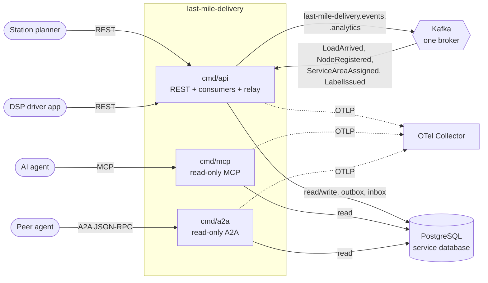

# Architecture

`last-mile-delivery` is a hexagonal Go service: the domain is pure, the application layer owns the use cases and the ports, and every protocol or store is an adapter. Dependencies point inward only, and the rule is an executable test (`TestHexagonalArchitecture`, `internal/architecture/architecture_test.go`), not a convention.

## Layout

```
cmd/
  api/                       composition root: REST + three Kafka consumers + outbox relay
  mcp/                       read-only MCP server (Streamable HTTP)
  a2a/                       read-only A2A agent (JSON-RPC)
internal/
  domain/                    wave, route, partner, history, shared: pure Go, no I/O
  application/
    ports/                   interfaces only (repositories, UnitOfWork, EventEncoder, Clock, IDs, AttemptMetrics)
    usecases/                one struct per use case + the policies
    repository/              query filters   outbox/  message types   views/  read models and DTOs
  adapters/
    inbound/http/            chi router, handlers, RFC 9457 problems, Idempotency-Key, /healthz /readyz
    inbound/kafka/           three consumers, inbox, retry, dead letter, tracing
    inbound/mcp/             three read-only tools
    inbound/a2a/             two read-only skills, Agent Card
    inbound/requestlog/      access-log middleware shared by the routers
    outbound/postgres/       pgxpool repositories, UnitOfWork, outbox, idempotency store, embedded migrations
    outbound/kafka/          event encoder, relay sink (Kafka writer), broker health check
    outbound/outbox/         the relay loop
    outbound/telemetry/      OTel setup, slog trace handler, the business counter
    outbound/system/         wall clock, id source
    outbound/memory/         test doubles only (never linked into cmd/**)
    outbound/repocontract/   one repository contract run against doubles and Postgres
    kafka/cloudevents/       the ONLY CloudEvents envelope builder/decoder
  bootretry/                 bounded backoff for the first outbound dials
  testing/{pgtest,kafkatest} testcontainers helpers
  architecture/              the fitness tests
apis/                        openapi.yaml, asyncapi.yaml
features/                    godog feature files
charts/last-mile-delivery/   Helm chart
web/                         operator micro-frontend (last_mile_mfe)
```

Source: directory tree at `develop`, `internal/architecture/`.

## Binaries

| Binary | Role | Port (default) | Reads | Writes | Kafka |
| --- | --- | --- | --- | --- | --- |
| `cmd/api` | REST API (12 operations) + `/healthz` + `/readyz`; three consumers (`linehaul`, `node-topology`, `shipping`); always-on outbox relay | `:8080` (`HTTP_ADDR`) | Postgres | Postgres, Kafka | yes: consumes 3 topics, produces 2 |
| `cmd/mcp` | MCP over Streamable HTTP at `/mcp` and `/`, `/healthz`; tools `list_waves`, `get_wave_stops`, `get_route` | `:8090` (`MCP_ADDR`) | Postgres | nothing | never dialled |
| `cmd/a2a` | A2A JSON-RPC at `/` and `/a2a`, Agent Card at `/.well-known/agent-card.json`, `/healthz`; skills `list_waves`, `get_route` | `:8093` (`A2A_ADDR`) | Postgres | nothing | never dialled |

`cmd/mcp` and `cmd/a2a` are structurally read-only: only the read use cases are wired, so they cannot insert into the outbox. All three run the idempotent embedded migrations at boot (golang-migrate advisory lock makes concurrent starts safe). REST, MCP and A2A are unauthenticated; access control is the in-cluster boundary. If any consumer or the relay of `cmd/api` ends on its own the process exits non-zero so the orchestrator restarts it.

## Container diagram



Source: `cmd/api/main.go`, `cmd/mcp/main.go`, `cmd/a2a/main.go`, `cmd/api/wiring.go`.

## Process model of `cmd/api`

`run(ctx)` validates the environment (before anything is dialled), starts telemetry, runs the migrations with retry, opens the pgx pool (10 connections, `statement_timeout = 5s`), pings Postgres with retry, builds the router, starts the three consumers and the relay as goroutines and serves HTTP. On SIGINT/SIGTERM it flips `/readyz` to not-ready, waits `SHUTDOWN_DRAIN_DELAY`, shuts HTTP down, then stops the consumers and the relay, and flushes telemetry last. See the [Runbook](/docs/operations/runbook).

Request path: `RequestID`, `otelchi` span, request-duration histogram, access log, `Recoverer`, NUL rejection; then for state-changing `POST`s the `Idempotency-Key` middleware (a Postgres advisory lock on `(METHOD path, key)`, replay of the stored 2xx response), then the handler, which calls one use case.

Write path: a use case runs in `UnitOfWork.Do` (one Postgres transaction): load, apply the command, save with an optimistic `version` check, append the events to `outbox_events` (encoded to CloudEvents at that moment, with `traceparent`), commit. The relay later claims unpublished rows with `FOR UPDATE SKIP LOCKED`, sends them and marks them published; failures count `attempts` up to `OUTBOX_MAX_ATTEMPTS`.

Read path: queries bypass aggregates' write path; `ListWaves`, `GetWaveStops` and `GetRoute` read through the same repositories and are used verbatim by REST, MCP and A2A.

## Data stores

One PostgreSQL database owned by this service (15 tables, all from `0001_last_mile_delivery_schema.up.sql`):

| Group | Tables |
| --- | --- |
| Aggregates | `delivery_waves`, `wave_inductions`, `routes`, `route_stops`, `route_stop_packages`, `route_attempts`, `delivery_service_partners`, `package_histories` |
| Read models | `rm_stations`, `rm_station_service_areas`, `rm_package_stops`, `rm_inbound_packages` |
| Infrastructure | `outbox_events`, `processed_events` (inbox), `idempotency_keys` |

No foreign key crosses an aggregate or a context; ids of other aggregates are carried by value. Kafka holds the two produced topics and the three consumed topics (plus `<topic>.dlq`); topics are auto-created. There is no cache and no other store. Detail: [Entity-relationship diagram](/docs/ddd/entity-relationship).

## Key design decisions

| Decision | Where |
| --- | --- |
| bounded context and its place in the network | [ADR 0001](/docs/adr/0001-last-mile-delivery-bounded-context) |
| aggregates, invariants and assumptions A1-A29 | [ADR 0002](/docs/adr/0002-aggregates-and-invariants) |
| consumed contracts and local read models | [ADR 0003](/docs/adr/0003-consumed-contracts-and-local-read-models) |
| CloudEvents envelope and type catalogue | [ADR 0004](/docs/adr/0004-cloudevents-envelope-and-type-catalogue) |
| runtime, outbox, HTTP and readiness | [ADR 0005](/docs/adr/0005-runtime-outbox-http-and-readiness) |
| read-only MCP server | [ADR 0006](/docs/adr/0006-mcp-server-adoption) |
| console remote | [ADR 0007](/docs/adr/0007-console-remote) |
| fleet observability standard | [ADR 0008](/docs/adr/0008-fleet-observability-standard) |
| A2A inbound adapter | [ADR 0009](/docs/adr/0009-a2a-inbound-adapter) |

Class and sequence views: [Class diagram](/docs/ddd/class-diagram), [Sequence diagrams](/docs/ddd/sequence-diagrams).
